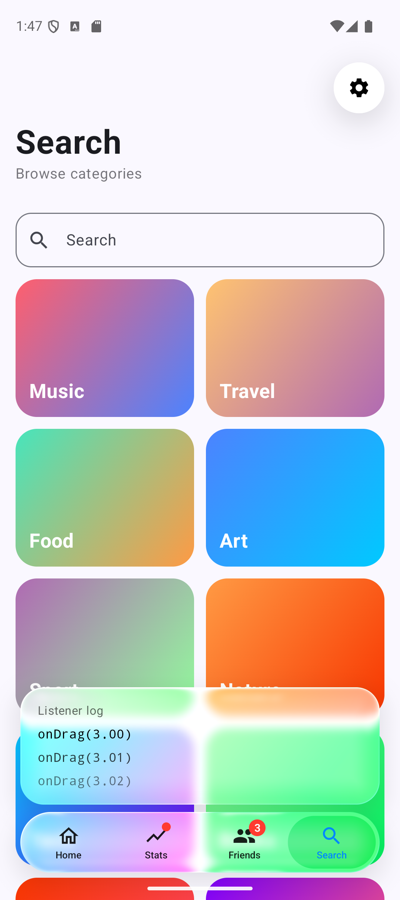
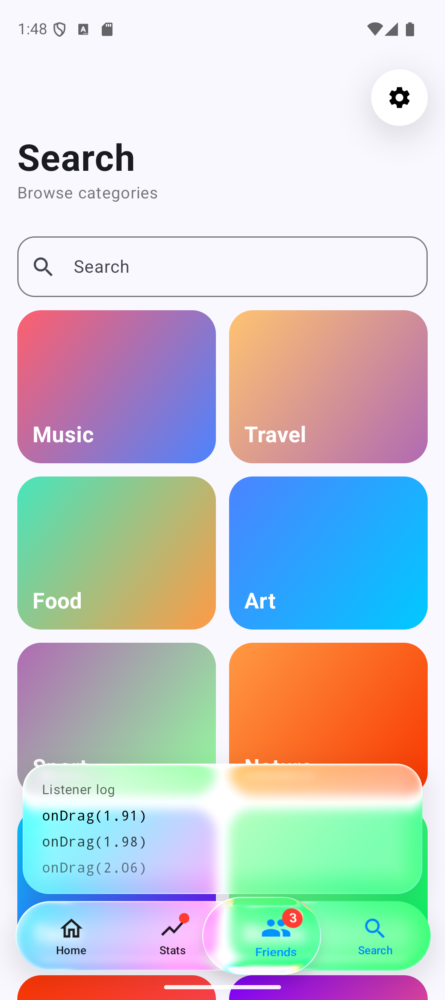
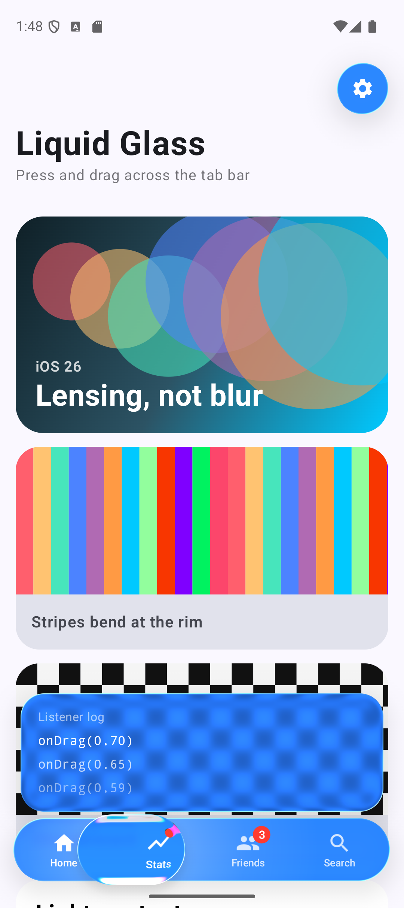
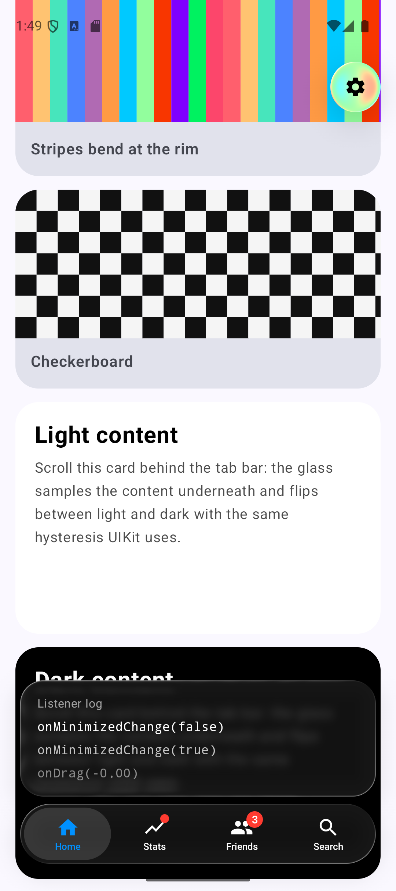

# iOS Liquid Glass Navigation for Android

[](https://jitpack.io/#slaviboy/iOSGlassNavigation)

A Jetpack Compose recreation of the **iOS 26 Liquid Glass tab bar**. The bar bends the light of
the content behind it. Press anywhere on it and the selection lifts into a clear glass droplet that
follows your finger and magnifies the tab under it. Release to select. Every iOS setting that
changes Liquid Glass is exposed: Clear/Tinted, Reduce Transparency, Increase Contrast and
Reduce Motion, plus fine-grained optics.

| Light glass | Lens while dragging | Tinted (blue) | Adaptive dark |
|---|---|---|---|
|  |  |  |  |

- **`:liquidglass`**: the library. No Material dependency; it uses only `androidx.compose.foundation`/`ui`.
- **`:app`**: a demo with procedural colorful content, a live settings panel for every parameter, and a listener log.

## Features

- **Real refraction (lensing).** An AGSL shader bends the backdrop at the glass bezel, using
  the measured iOS profile (the sag of a circular arc). The rest of the glass is a frosted face
  that keeps the backdrop's colors but squeezes its brightness, as UIKit does.
- **The lifted lens.** Press and drag: the resting pill lifts into a clear droplet 8 dp larger
  than the pill on every side, overhanging the bar. Inside it you see:
  - inner refraction and an outward warp;
  - 7-tap chromatic dispersion at the rim;
  - a lit rim and a top shade;
  - the tab content magnified 1.16× in the accent color.
- **iOS physics.** All springs and timings come from frame-by-frame measurements of UIKit:
  - lift (critically damped, 15 ms after touch-down);
  - lens trailing the finger, then catching up 24 ms after release;
  - 220 ms hang after a tap;
  - the bar swelling 3.55% with ~8% overshoot and stretching toward the finger;
  - soft-body flex of the droplet when it accelerates or brakes;
  - fingertip glow and press wash.
- **Adaptive light/dark (opt-in).** With `colorScheme = GlassColorScheme.Adaptive`, the bar
  samples the content behind it and flips between light and dark glass with UIKit's hysteresis
  thresholds. Glass colors follow on a 0.5 s spring.
- **Device-tilt highlights.** The specular rim rotates as you tilt the phone.
- **Minimize on scroll.** As with `tabBarMinimizeBehavior`, the bar collapses to a circle with the
  current tab and expands again on scroll back, at the top, or on tap.
- **Haptics and badges.** A tick for each tab the lens crosses, a confirmation on selection, and
  dot, count or text badges.
- **Listeners.** `onTabSelected`, `onTabReselected`, `onPressStart`, `onDrag(fractionalIndex)`,
  `onRelease(index, cancelled)` and `onMinimizedChange`.
- **Generic glass.** `Modifier.liquidGlass(...)` and `LiquidGlassBox` turn any composable into the
  same material.
- **Graceful fallbacks** down to API 24 (see [Render tiers](#render-tiers)).

## Add to your project

Add the JitPack repository.

**`settings.gradle.kts` (Kotlin DSL)**
```kotlin
dependencyResolutionManagement {
    repositories {
        google()
        mavenCentral()
        maven { url = uri("https://jitpack.io") }
    }
}
```

**`settings.gradle` (Groovy DSL)**
```groovy
dependencyResolutionManagement {
    repositories {
        google()
        mavenCentral()
        maven { url 'https://jitpack.io' }
    }
}
```

Add the dependency.

**`build.gradle.kts` (Kotlin DSL)**
```kotlin
dependencies {
    implementation("com.github.slaviboy:iOSGlassNavigation:1.0.0")
}
```

**`build.gradle` (Groovy DSL)**
```groovy
dependencies {
    implementation 'com.github.slaviboy:iOSGlassNavigation:1.0.0'
}
```

> JitPack publishes a single-module library under the **repository name**, so the artifact is
> `iOSGlassNavigation`, not the module name `liquidglass`.

Requirements: `minSdk` 24, Jetpack Compose (BOM 2026.02 or newer recommended).

## Quick start

```kotlin
@Composable
fun App() {
    val backdrop = rememberLiquidGlassBackdrop()
    val tabBarState = rememberLiquidGlassTabBarState()

    LiquidGlassTheme {
        Box(Modifier.fillMaxSize()) {
            // 1. Everything the glass refracts. Must have an opaque background.
            Box(
                Modifier
                    .fillMaxSize()
                    .liquidGlassBackdrop(backdrop)
                    .background(Color.White)
                    .nestedScroll(tabBarState.nestedScrollConnection) // for minimize-on-scroll
            ) {
                Screen(tabBarState.selectedIndex, bottomPadding = LiquidGlassTabBarDefaults.contentBottomPadding())
            }

            // 2. The tab bar: a later sibling of the backdrop, never inside it.
            LiquidGlassTabBar(
                items = listOf(
                    LiquidGlassTabItem("Home", Icons.Outlined.Home, selectedIcon = Icons.Filled.Home),
                    LiquidGlassTabItem("Stats", statsIcon, badge = LiquidGlassBadge.Dot),
                    LiquidGlassTabItem("Friends", friendsIcon, badge = LiquidGlassBadge.Count(3)),
                    LiquidGlassTabItem("Search", searchIcon)
                ),
                backdrop = backdrop,
                modifier = Modifier.align(Alignment.BottomCenter),
                state = tabBarState,
                minimizeBehavior = TabBarMinimizeBehavior.OnScrollDown,
                onTabSelected = { index -> /* navigate */ },
                onTabReselected = { index -> /* scroll to top */ }
            )
        }
    }
}
```

### Custom tab content

Use the slot overload to draw anything in a tab. `LiquidGlassTabScope` tells you whether the tab
is selected, its resolved color, the minimize progress, and whether you are drawing the
accent-colored copy that is only visible through the lens.

```kotlin
LiquidGlassTabBar(tabCount = 3, backdrop = backdrop) { index ->
    Text("Tab $index", color = contentColor, fontWeight = if (isSelected) FontWeight.Bold else null)
}
```

### Glass on anything

```kotlin
LiquidGlassBox(backdrop, Modifier.size(52.dp).clickable { }, shape = CircleShape, interactive = true) {
    Icon(Icons.Default.Settings, null, tint = LocalLiquidGlassContentColor.current)
}

// or, without the adaptive content color:
Modifier.liquidGlass(backdrop, RoundedCornerShape(24.dp))
```

## Settings (the iOS switches)

`LiquidGlassSettings` is passed to `LiquidGlassTheme` (for every glass element) or to a single
component.

**Defaults:** clear, dark glass (`variant = Clear`, `colorScheme = Dark`), and the tab bar never
minimizes (`minimizeBehavior = TabBarMinimizeBehavior.Never`). To get iOS's own defaults, use:

```kotlin
LiquidGlassSettings(variant = GlassVariant.Regular, colorScheme = GlassColorScheme.Adaptive)
```

| Setting | iOS equivalent | Effect |
|---|---|---|
| `variant = Regular / Clear / Identity` (default `Clear`) | `Glass.regular / .clear / .identity` | Regular is frosted and adaptive. Clear is barely frosted and dims bright content by 35%. Identity draws no glass. |
| `appearance = Clear / Tinted` (default `Clear`) | Settings › Display & Brightness › Liquid Glass (iOS 26.1) | Tinted increases the opacity and contrast of the glass. |
| `colorScheme = Adaptive / Light / Dark` (default `Dark`) | automatic light/dark flipping of small glass | Adaptive samples the backdrop with UIKit's hysteresis. Light and Dark are fixed. |
| `accessibility.reduceTransparency` | Accessibility › Reduce Transparency | Frostier, more opaque glass with no refraction. |
| `accessibility.increaseContrast` | Accessibility › Increase Contrast | Mostly black or white glass, a contrasting border, and contrast blue `#1E6EF4`. |
| `accessibility.reduceMotion` | Accessibility › Reduce Motion | No lift, swell, flex or tilt; the selection slides. |
| `followSystem` | n/a | Mirrors Android's *Remove animations*, the Android 14 *contrast* setting / high-contrast text, and (opt-in) missing cross-window blur. |
| `deviceTiltHighlight` | motion-reactive highlights | Rotates the specular light with device tilt. |
| `haptics` | n/a | Tick per tab crossed, confirmation on selection. |
| `renderTier = Auto / Full / Blur / Basic` | n/a | Forces a lower quality tier. |

## Style (the optics)

`LiquidGlassStyle` defaults reproduce iOS 26. Every value can be tuned, and the demo's settings
panel has a slider for each.

| Property | Meaning |
|---|---|
| `platter` / `lens` (`GlassOptics`) | `blurRadius`, `refractionAmount`, `refractionHeight` (bezel width), `warpAmount`, `warpHeight`, `chromaticAberration` |
| `frost` | 0 = crystal clear, 1 = iOS, 2 = milky |
| `vibrancy` | Saturation of the backdrop seen through the glass |
| `specularIntensity`, `specularAngle`, `specularFalloff`, `rimWidth` | The lit rim |
| `tintColor`, `tintIntensity` | Colored glass, mapped to the brightness underneath (as in the tinted iOS bar) |
| `accentColor` | Selected tab color (iOS system blue by default) |
| `shadow`, `lensShadow` | Soft drop shadows |
| `lensMagnification` | Scale of the content inside the lifted lens |

Sizes (62 dp bar, 21 dp margins, 4 dp inset, 8 dp lens growth, 56 dp minimized circle) are in
`LiquidGlassTabBarDefaults.dimensions()`. Colors are in `LiquidGlassTabBarDefaults.colors()`.

## Render tiers

| | Full (API 33+) | Blur (API 31–32) | Basic (API 24–30) |
|---|---|---|---|
| Bar | AGSL refraction, frosted face, lit rim | blurred, saturated backdrop with UIKit's face mapping; gradient rim | frosted translucent fill; gradient rim |
| Lens | AGSL refraction, warp, dispersion, rim | magnified, clipped backdrop; gradient rim | translucent capsule with the magnified accent icons |
| Physics, haptics, minimize, shadows, adaptive | ✓ | ✓ | ✓ |

The tier is chosen automatically. If AGSL fails to compile on a driver, the Blur tier is used.

## Rules

- The glass must be a **sibling drawn after** the content marked with `liquidGlassBackdrop`,
  never inside it.
- Give the backdrop an **opaque background** (or pass `rememberLiquidGlassBackdrop(backgroundColor)`).
- **Ancestors of the tab bar must not clip.** The lens and the shadows draw outside the bar.
- Glass shapes are rounded rectangles. Other `Shape`s are approximated by their bounds.

## Performance

- **One capture.** The backdrop is recorded once into a `GraphicsLayer`. Glass elements draw it
  by reference, so scrolling the content costs no Kotlin work.
- **Cached blur.** The frosted backdrop of the bar lives in its own layer, which the GPU keeps
  cached while the bar animates. Only the cheap refraction shader runs per frame.
- **Small lens layer.** The lens layer only covers the lens.
- **No recomposition.** Physics run in plain floats with one snapshot write per frame, so
  animation never recomposes.
- **Cheap shadows.** They are analytic Gaussian gradients; nothing is rasterized.
- **Async adaptive sampling.** On API 33+ the 24×6 luma image is rendered by a persistent
  `HardwareRenderer` and read on a background thread.

## Testing

```
./gradlew :liquidglass:testDebugUnitTest            # springs, physics timelines, geometry, color math, settings
./gradlew :liquidglass:connectedDebugAndroidTest    # compiles the AGSL programs on a device
```

## Credits

- Optical and physical constants of the iOS 26 tab bar were measured from UIKit by
  [Liquidum](https://github.com/mohamedalsamrai/liquidum) (MIT).
- Rendering techniques were inspired by Kyant's
  [AndroidLiquidGlass / Backdrop](https://github.com/Kyant0/AndroidLiquidGlass) (Apache-2.0)
  and [kube.io](https://kube.io/blog/liquid-glass-css-svg/). No code was copied.
- The rounded-rectangle SDF is by Inigo Quilez.
- Design reference: Apple WWDC25 *Meet Liquid Glass* and the Human Interface Guidelines. No Apple assets are included.

See [NOTICE](NOTICE).

## License

```
Copyright (C) 2022 Stanislav Georgiev
https://github.com/slaviboy

Licensed under the Apache License, Version 2.0 (the "License");
you may not use this file except in compliance with the License.
You may obtain a copy of the License at

    http://www.apache.org/licenses/LICENSE-2.0

Unless required by applicable law or agreed to in writing, software
distributed under the License is distributed on an "AS IS" BASIS,
WITHOUT WARRANTIES OR CONDITIONS OF ANY KIND, either express or implied.
See the License for the specific language governing permissions and
limitations under the License.
```
